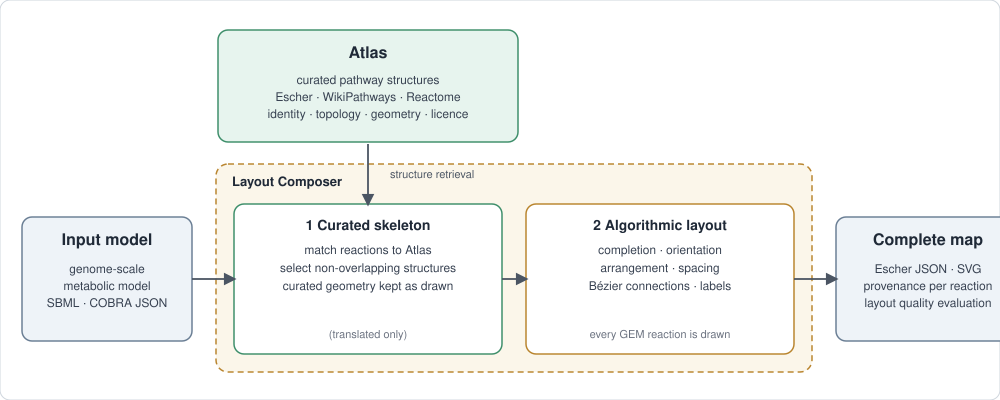
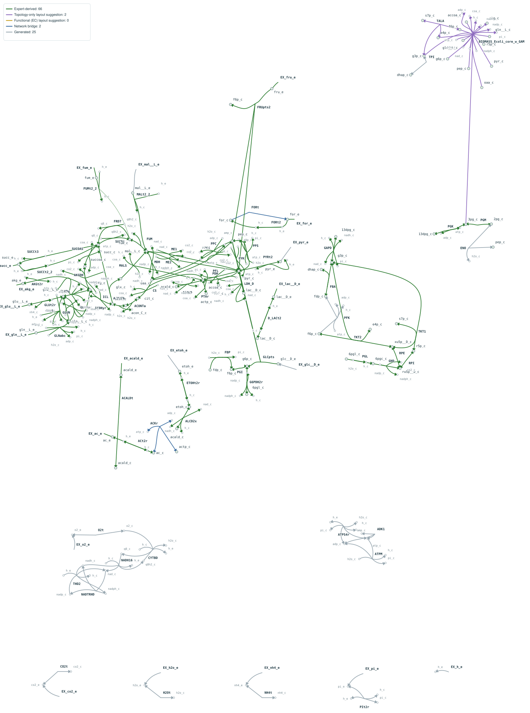

# Open Meta Maps

Open Meta Maps automatically converts genome-scale metabolic models (GEMs) into complete, expert-informed metabolic maps. It reuses curated pathway layouts where possible and algorithmically arranges the remaining reactions, producing editable Escher JSON, SVG and provenance reports.

Developed as part of ELIXIR BioHackathon Europe 2026.

## Workflow



Reactions of the input model are matched to expert-drawn structures in the **Atlas**. The matched structures form a skeleton whose geometry is kept as drawn; every other reaction is placed algorithmically and connected with curved edges. Nothing is dropped: all reactions and metabolites of the model appear in the map.

## Example result



*The `e_coli_core` example (95 reactions), generated with the commands in the quick start and not retouched. Green connections come from expert structures (66 reactions); the legend inside the figure lists the other sources. The current limitations are visible, for example some long connections and pathways that are not yet placed next to the pathways they connect to; see [docs/limitations.md](docs/limitations.md).*

## Key features

- **Complete GEM coverage**: every reaction and metabolite of the input model is drawn; stoichiometry and compartments are not changed.
- **Expert-informed pathway layouts**: pathway structures and their geometry are reused from curated maps (Escher maps, WikiPathways, Reactome) through the Atlas.
- **Automatic layout completion**: reactions without a suitable expert structure are arranged algorithmically, connected with Bézier curves, labelled and checked with layout-quality measures.
- **Editable maps with transparent provenance**: Escher JSON and SVG output, and a record for every reaction of whether its layout is expert-derived, a topology-only or EC-based suggestion, a bridge, or generated.

## Quick start

Requirements: Python 3.11+, Node.js with npm, a C++ compiler (`clang++`) and network access for the first setup. SBML files are read with libSBML (installed with the Python requirements); COBRA / BiGG JSON is also supported.

```sh
git clone https://github.com/yangziwei96/OpenMetaMaps.git
cd OpenMetaMaps

python3 -m pip install -r layout_atlas/requirements.txt
npm ci --prefix layout_atlas/runtime
python3 project.py setup        # one-time: build the edge routers
```

Start the web tool and open <http://127.0.0.1:8765/tool/index.html>:

```sh
python3 project.py tool
```

Upload an SBML or COBRA JSON model, generate a map and download the results. On macOS, `./start_tool.command` does the same and opens the browser.

Command line:

```sh
python3 project.py compose --gem examples/e_coli_core.xml --out results/e_coli_core/ --source-paths --layout-style expert
```


Layout evaluation (development aid, Project 22 metrics): `pip install -r layout_atlas/requirements-eval.txt`, then `python3 project.py evaluate --gem MODEL.xml --map DIR/map.json`. See [docs/layout_evaluation.md](docs/layout_evaluation.md).

## How it works

- **Atlas**: a knowledge base of reusable pathway structures extracted from expert-drawn maps. It records network topology, reaction identity, geometry, source information and licensing metadata.
- **Layout Composer**: matches the input model to Atlas structures by reaction identity, equation and topology, selects non-overlapping structures as a skeleton, places the remaining reactions around it, routes the connections and evaluates geometric quality.

Layout quality and expert-geometry reuse are reported separately; exact matches, topology-only references and EC-based suggestions are never merged into one reuse rate. See [docs/methodology.md](docs/methodology.md).

## Outputs and provenance

| Output | Description |
|---|---|
| `map.json` | Editable Escher map |
| `map.svg` | Vector visualisation |
| `report.json` | Coverage (expert geometry reuse versus algorithmic completion) and layout-quality measures |
| `reaction_provenance.json` | For every reaction: expert-derived, topology-only suggestion, functional (EC) suggestion, bridge or generated, with the matching evidence |
| `layout_issues.json` | Locations of crossings, collisions and other layout problems |
| `licenses.json` | Licensing metadata of the Atlas structures used |

## Data sources and licensing

The default Atlas (`data/open_core.sqlite`, copied to `atlas.sqlite` on first run) integrates pathway knowledge from Escher maps, Human-maps, WikiPathways, Reactome and BRENDA. Source versions, hashes and licence evidence are in `data/source_inputs/`. Every original source is credited in [THIRD_PARTY_NOTICES.md](THIRD_PARTY_NOTICES.md) together with the licence recorded for it; items whose licence is still to be confirmed are marked as such, see [docs/licensing_audit.md](docs/licensing_audit.md). BRENDA pathway modules (CC BY 4.0) are included by default; layout provenance is marked possibly automatic so expert Escher/WikiPathways/Reactome modules are preferred when equivalent.

The repository software licence is **to be specified before the public release**; it is independent of the licences of the data.

## Documentation

- [Installation](docs/installation.md)
- [Data sources and licensing](docs/data_sources.md)
- [Optional data packages](docs/data_packages.md)
- [Methodology](docs/methodology.md)
- [Limitations](docs/limitations.md)
- [Atlas data layout](data/README.md) and [code overview](layout_atlas/README.md)

## Project status

Open Meta Maps is under active development. Ongoing work focuses on global pathway organisation, reducing visual overlap and keeping layouts consistent across genome-scale models.

## Citation and acknowledgements

A citation will be added with the first release. Until then, please cite this repository and the sources listed in [THIRD_PARTY_NOTICES.md](THIRD_PARTY_NOTICES.md).

Developed during ELIXIR BioHackathon Europe 2026, building on the work of the Escher, WikiPathways, Reactome and wider metabolic modelling communities.
