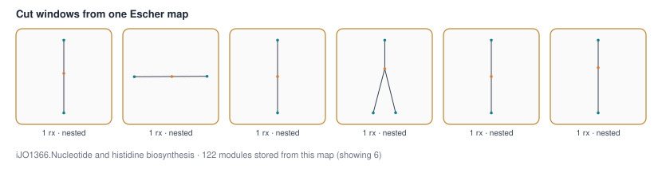
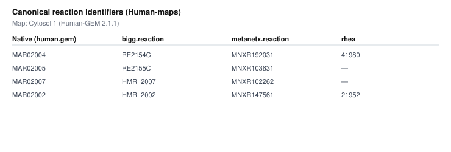
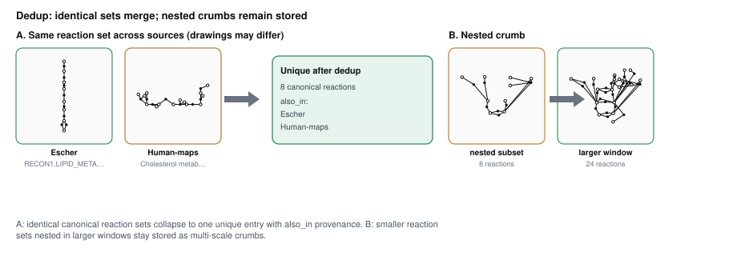
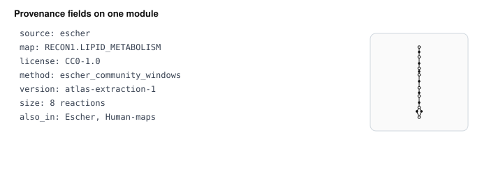
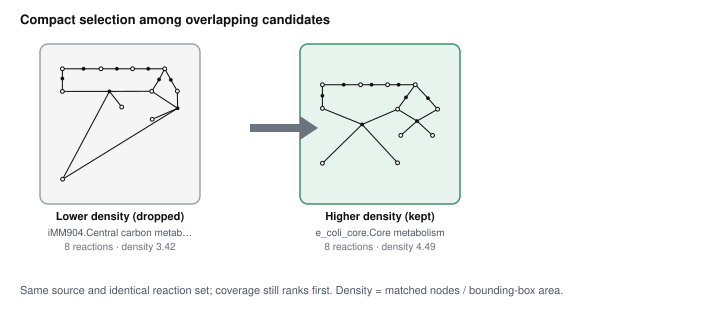

# Atlas data management

Status: 2026-11-12. How curated layouts are cut, stored, identified and selected. Not legal advice. **Authoritative counts and licences:** [`data/atlas_registry.json`](../data/atlas_registry.json) (regenerated by `layout_atlas/atlas_registry.py`; the About page reads the same file via `layout_atlas/navigation.py`). Plain-language summary and figures: README / About → *1. Data construction*. Dedup stats and figures: `PYTHONPATH=layout_atlas python3 tools/atlas_module_figures.py all`.

## Inventory

| Store | Role |
|---|---|
| `data/open_core.sqlite` | Redistributable Atlas (tracked). Tables: `maps`, `modules`, `reactions`, `reviews`, `retained_observations`. Open-core modules: Escher (in-repo `escher_cutter` / `escher_community_windows`, parity-tested) + Reactome + WikiPathways semantic. |
| `data/atlas.sqlite` | Runtime working copy (gitignored). Copied from `open_core.sqlite` on first run (`core.py`). |
| `data/extensions/*/modules.json.gz` | Default extensions (BRENDA, Human-maps, WikiPathways geometry, Metabolism Regulation, PANTHER, iCH360) loaded by `database.modules()`. Units exist under `extensions/units/` but are **not** in the default load. Counts: see `atlas_registry.json`. |
| `data/atlas_registry.json` | Machine-readable build/registry summary (counts, licences, per-source extraction methods, input manifest and source-registry hashes). |
| `data/source_inputs/` | Observations, raw inputs, `source_registry.json`, crosswalks, terms snapshots. |
| `data/input_manifest.json` | SHA-256 of files under `source_inputs/` (version label `0.3-source-inputs`). |
| `data/acquisition.json` | Acquisition ledger (Reactome diagrams, reference paths, failures). |
| `data/packages.json` | Optional release packages (`atlas-full` only). |

`database.build()` rebuilds `atlas.sqlite` from the in-repo Escher cutter, WikiPathways GPML, Reactome archive, and non-Escher observations (geometry-only WikiPathways). Surgical rebuilds: `escher_rebuild.py` (Escher), `reactome_recut.py` (Reactome), `wikipathways_rebuild.py` (WikiPathways semantic + geometry extension), `human_maps_library.py` (Human-maps), `ich360_library.py` (iCH360), `panther_library.py`, `metabolismregulation_library.py`. `atlas_registry.normalize_open_core()` fills provenance (including `extraction`) without recutting windows.

## Stage B window policy (`diagram_modules`)

Coverage-preserving defaults for every source that uses `database.diagram_modules` (Reactome, WikiPathways semantic + geometry, Human-maps, Metabolism Regulation, PANTHER, iCH360):

- **Size-scaled roots (`root_policy=all_roots_upto_48_else_max_roots_24`):** all reactions when \(N \le 48\); otherwise cap at 24 roots (large maps stay tractable; small maps keep full root coverage).
- **Near-nested dedupe (`nest_factor=2`):** a window S nested in T is dropped when |T| ≤ 2·|S| (size-2 ⊂ size-4, size-4 ⊂ size-8, size-8 ⊂ size-12/16, size-12 ⊂ size-24 go; size-2 ⊂ size-12/24 stays as a multi-scale seed).
- **Size-1/2 windows that are not near-nested stay stored** (useful on small models). Preference is handled in `retrieval.select` (geometry-crumb demotion + complete-equation bonus), not by deleting non-nested crumbs from the library.
- Provenance records `independent_only`, `nest_factor`, `root_policy`, `raw_windows_before_dedupe`, and `counts.independent_modules`.

Surgical rebuild entrypoints on the build path: `reactome_recut.py` (Reactome open-core only), `human_maps_library.py`, `wikipathways_rebuild.py`, `ich360_library.py`, `panther_library.py`, `metabolismregulation_library.py`. Escher community windows remain on `escher_community_windows` (unchanged cutter). BRENDA remains on `brenda_library.extract` (not `diagram_modules`).

### Stage B library counts (main → Stage B)

| Source | method | modules before | after | nested-share before | after |
|---|---|---:|---:|---:|---:|
| Reactome | `diagram_modules` | 3405 | 1811 | 0.8288 | 0.6781 |
| WikiPathways semantic | `diagram_modules` | 1245 | 669 | 0.8016 | 0.6308 |
| WikiPathways geometry | `geometry_modules` | 29673 | 15611 | 0.0 | 0.0 |
| Human-maps | `diagram_modules` | 8540 | 4690 | 0.8001 | 0.6352 |
| iCH360 | `diagram_modules` | 858 | 436 | 0.8601 | 0.7248 |
| PANTHER | `diagram_modules` | 238 | 138 | 0.8109 | 0.6739 |
| Metabolism Regulation | `diagram_modules` | 423 | 229 | 0.6643 | 0.3799 |
| Escher | `escher_community_windows` | 13047 | 13047 | 0.8666 | 0.8666 |
| BRENDA | `brenda_library.extract` | 11703 | 11703 | 0.9719 | 0.9719 |
| Units (companion) | `units_library.decompose` | 2963 | 2963 | 0.0 | 0.0 |

Size-1/2 crumbs remain in every recut library (example: Human-maps after still has 2722 size-1/2 modules). On iIT341, 46 selected complete-equation modules are size-2 — crumbs do win verified matches and must stay stored.

`units_library.decompose` remains a **companion layer** (`data/extensions/units/`; not in the default `database.modules()` load). Use `--library units_sub` for units + on-demand sub-windows.

## Provenance on every map and module

Open-core and extension map payloads carry `source`, `license`, `source_sha256`, `species`, `lineage`, `name`, `provenance_status`, `attribution`, `layout_origin`, `version`, and `atlas_schema_version` when normalized. Escher and WikiPathways maps also carry `url` / `source_path` when the registry row is known. Reactome maps take URL/version from `acquisition.json` during normalization.

Every module payload duplicates the indexed columns and includes `license`, `source_sha256`, `original_instance`, `layout_origin`, `atlas_schema_version`, `core_family`, `variant`, `geometry_fingerprint`, and an **`extraction`** block:

```json
"extraction": {
  "method": "diagram_modules",
  "version": "atlas-extraction-1",
  "parameters": {
    "max_roots": 25,
    "window_sizes": [1, 2, 4, 8, 12, 24],
    "independent_only": true,
    "nest_factor": 2.0,
    "root_policy": "all_roots_upto_48_else_max_roots_24",
    "raw_windows_before_dedupe": 144
  },
  "counts": {
    "source_events": 95,
    "modules": 40,
    "reactions_covered": 79,
    "coverage": 0.8316,
    "independent_modules": 40
  }
}
```

| Method | Used for | Notes |
|---|---|---|
| `escher_community_windows` | Open-core Escher (`escher_cutter`) | All roots; sizes 1–40; reproducible |
| `diagram_modules` | Reactome, WikiPathways semantic, Human-maps, Metabolism Regulation, PANTHER, iCH360 | Size-scaled roots; independent windows only |
| `geometry_modules` | WikiPathways geometry extension | Same cutter over metabolite–metabolite GPML edges |
| `brenda_library.extract` | BRENDA extension | Singletons, pairs, windows, components |
| `units_library.decompose` | Units extension (companion layer) | Non-overlapping 3–12 reaction units |
| `legacy_observations` | Remaining `from_legacy` path (geometry-only observations) | `version: unreproducible`, `inferred: true` |

Registry `extraction.by_source` summarises method, parameters, map/module counts per source. Extensions (including iCH360) carry `layout_origin` / `provenance_status` on modules.

### Reaction identifiers

| Source | Native namespace | Canonical namespaces |
|---|---|---|
| Escher community | `bigg.reaction` (true BiGG) | already canonical |
| Reactome | `reactome` | already canonical |
| WikiPathways semantic | `rhea` | already canonical |
| Human-maps | `human.gem` (MAR) | `bigg.reaction` / `metanetx.reaction` / `rhea` via Human-GEM `reactions.tsv` (CC BY 4.0) |
| Metabolism Regulation | `sbgn.process` | `rhea` when participant ChEBI uniquely matches a Rhea equation |
| PANTHER | `celldesigner.reaction` | none yet (no unique Rhea match without inventing ids) |
| iCH360 | `bigg.reaction` (true BiGG) | already canonical |
| BRENDA | `ec-code` (+ svg token) | EC kept as-is |

Remap tooling: `layout_atlas/canonical_ids.py`. Crosswalk: `data/source_inputs/crosswalks/`.

## Duplication and overlap (default Atlas)

Computed by `tools/atlas_module_figures.py` from the loaded modules ([`docs/images/atlas/atlas_overlap.json`](../docs/images/atlas/atlas_overlap.json)). Dedup key: canonical reaction-id set (preferred namespaces BiGG / MetaNetX / Rhea / Reactome / EC / native); WikiPathways geometry-only windows use `geometry_fingerprint` because they store no chemical reaction ids.

| Metric | Value |
|---|---:|
| Cut modules (default load) | 48,334 |
| Unique after dedup (global) | 36,103 |
| Modules nested in a larger set | 28,587 |
| Cross-source identical sets | 552 |

Notable pairwise identical sets: Escher↔Human-maps 390; Escher↔iCH360 154; WikiPathways semantic↔Metabolism Regulation 10; Human-maps↔iCH360 3. Per-source modules vs unique counts are in the README / About table and the mosaic legend.

## Worked examples

Figures: `PYTHONPATH=layout_atlas python3 tools/atlas_module_figures.py worked` → [`docs/images/atlas/`](../docs/images/atlas/).

### 1. Cutting one source map into modules



A community Escher map is cut into reaction windows (sizes 1–40). The left panel shows the source map with window outlines; the right panel shows the resulting non-trivial modules. Near-nested crumbs may remain stored; Stage B drops only near-nested pairs under `nest_factor=2`.

### 2. Canonical reaction identifiers



Human-maps keep the native MAR id under `human.gem` and attach BiGG / MetaNetX / Rhea from the Human-GEM `reactions.tsv` crosswalk when annotated.

### 3. Dedup: identical sets and nesting



Exact duplicates across sources collapse to one unique reaction set with `also_in` listing every contributing source. Nested crumbs (smaller reaction sets inside larger windows) stay stored as multi-scale seeds. At compose time, `retrieval.select` still prefers the denser drawing among same-source equal sets.

### 4. Provenance on one module



Every module carries `source`, map name/id, `license`, and an `extraction` block (`method`, `version`, `parameters`, `counts`). When the same canonical set appears in multiple sources, the unique record lists `also_in`.

### 5. Compact selection



Among same-source biochemical proposals with identical reaction sets, only the denser drawing is kept (density = nodes / bounding-box area). Coverage still ranks first.

### Reactions / reviews / retained_observations

- `reactions`: identifier index (no licence).
- `reviews`: schema present, unused (0 rows).
- `retained_observations`: exclusion ledger (`disconnected_visible_core`, `outside_v03_size_bound`, `reactome_replaced_by_fixed_v97`).

## Retrieval ranking

`retrieval.select` keeps coverage (`2 × matched reactions`) as the dominant term and does not change `selection_score` for compactness. Among same-source proposals with identical reaction sets, only the denser drawing is kept (compactness `matched_nodes / bbox_area` breaks remaining ties). Stage B also:

- subtracts 3.0 for size≤2 geometry-only proposals (`biol < 1`) so crumbs cannot displace denser covers;
- adds 4.0 for complete-equation / stoichiometry-verified proposals;
- when ≥8 free-standing size≤2 CE crumbs overlap a size≥4 non-CE proposal, locks **all** size≤2 CE crumbs before geometry fill-in (pool-density rule on reaction sets only — no source- or model-id branches); sparse pools keep pure score order so larger CE packs are not fragmented;
- refuses geometry-only one-for-up-to-two exchanges that would drop complete-equation covers.

`layout_priority` still demotes `possibly_automatic` layouts (BRENDA).

### iIT341 complete-equation dip after nested `#24` (and fix)

Pre-`#24` (`4b51810`-era) iIT341 had CE share ≈0.300 (166/554). Nested `#24` dropped to 0.285 (158/554). The eight lost reactions (`ASP1DC`, `CDPMEK`, `DPR`, `DXPRIi`, `MECDPS`, `MEPCT`, `MOHMT`, `PANTS`) were size-2 Escher **complete-equation** covers displaced by size-4 WikiPathways/Human-maps **geometry** because `2×|R|` outscored the verified biol term. Stage B’s `COMPLETE_EQUATION_BONUS=4` restores all eight (and more): CE share 0.339 (188/554) with zero losses vs pre-`#24`. General rule: never let unmatched geometry outrank a stoichiometry-verified cover of the same reactions.

## Source registry

`data/source_inputs/source_registry.json` is the file-level ledger. Every row records **licence**, **URL**, **version**, **retrieval date**, and **extraction method**. Coverage includes WikiPathways, Escher, Metabolism Regulation, PANTHER, Reactome (archive-v97 diagrams), BRENDA, Human-maps, iCH360, and the Human-GEM reaction crosswalk. Surgical rebuilds must preserve `extraction_method` / `retrieval_date` when rewriting rows (see `wikipathways_rebuild.refresh_source_registry`).

File-row count stays 2524 vs `main` (nothing dropped). Earlier PR drafts that shrank the JSON by ~4.5k lines had wiped nested `extraction_method` fields during a rebuild; `normalize_open_core` / `write_registry` / extension backfill restore them (`none_em=0`). Binary `modules.json.gz` churn on untouched cutters (BRENDA) is provenance stamp-only (`extraction.counts.independent_modules`); Escher window geometry is unchanged aside from JSON float heal after normalize.

## WikiPathways layout

Pipeline: `layout_atlas/wikipathways_rebuild.py` over GPML in the **20261110** snapshot.

- Semantic modules stay in `open_core.sqlite`.
- Geometry-only windows live in `data/extensions/wikipathways_geometry/` so sqlite stays under GitHub’s size limit; both load by default via `database.modules()`.
- Licence: WikiPathways content is **CC0**; Atlas stamps `CC0-1.0`.

## Validation

`atlas_registry.validate()` fails on missing licence / source / `layout_origin` / `extraction.method` / schema version / dangling module `map_id`.

## Follow-ups

1. Keep `data/atlas_registry.json` and the About page in sync after every Atlas rebuild.
2. Raise PANTHER chemical retrieval when richer reaction annotations are available (do not invent unmapped identifiers).
